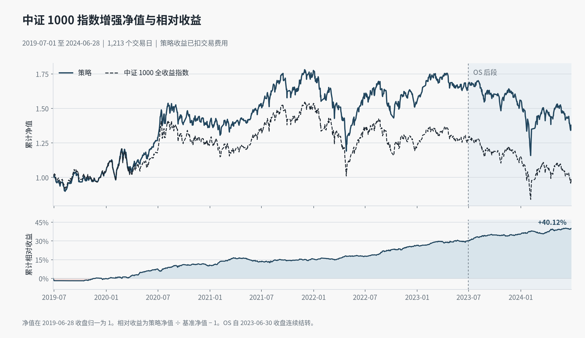
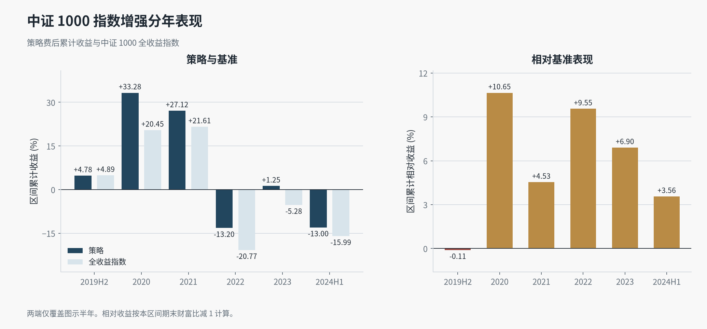
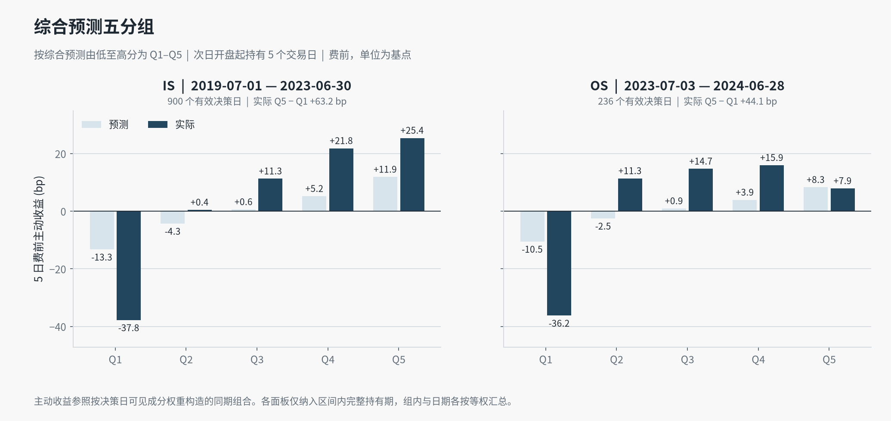

# 中证 1000 日频指数增强

在每天可见的中证 1000 成分股中，哪些股票值得比指数多持有一些？本项目使用自有数据源，从价格和成交行为估计未来五个交易日的主动收益，再以实际持仓、风险预算和交易费用决定次日开盘的委托。账户只做多，以中证 1000 **全收益指数**衡量业绩。

> 2019-07-01 至 2024-06-28 的 1,213 个交易日内，策略费后累计收益 **+35.74%**，同期指数 **−3.13%**。期初各投入 1 元，期末分别为 1.3574 元和 0.9687 元，策略相对基准的财富增长为 **40.12%**。

## 五年连续账户

| 指标 | 结果 |
| --- | ---: |
| 费后年化超额 / 信息比率 | **6.81% / 2.21** |
| 年化跟踪误差 / 相对最大回撤 | 3.09% / −3.43% |
| 组合绝对最大回撤 / 基准绝对最大回撤 | −34.92% / −45.58% |
| 累计收益差 / 累计相对收益 | 38.87 个百分点 / 40.12% |
| 相对净值的几何年化收益 | 7.26% |
| 日均单边换手 / 累计成交费用 | 1.54% / 44.14 万元 |



费后年化超额取日收益差的算术均值乘 252。累计相对收益取期末策略净值除以基准净值后减一。2019 年从现金建仓，首批标签成熟前维持被动复制，前 67 个交易日的建仓费用、持仓和收益均计入上表。[逐日净值 CSV](results/full-nav.csv) · [指标及计算口径](TECHNICAL.md)

## 哪些时期贡献了超额

| 连续账户切片 | 交易日 | 策略费后累计 | 基准累计 | 累计相对收益 | 费后年化超额 | 信息比率 |
| --- | ---: | ---: | ---: | ---: | ---: | ---: |
| 2019-07-01 至 2023-06-30（IS） | 972 | +67.84% | +28.94% | +30.17% | +6.66% | 2.10 |
| 2023-07-03 至 2024-06-28（OS） | 241 | −19.13% | −24.87% | +7.65% | +7.42% | 2.73 |

前四年选定组合配置。进入最后一年时沿用 6 月 30 日的现金和持仓，每月仍然只用当时已成熟的标签更新预测。在最后一年下跌的市场里，策略也发生了亏损，但跌幅较指数小 5.75 个百分点。



2019 年下半年累计相对收益为 −0.11%。此后四个完整日历年均为正，以 2020 年的 +10.65% 最高。2024 年上半年策略下跌 13.00%，同期指数下跌 15.99%，累计相对收益为 +3.56%。[分年、分半年和分段结果](results/full-metrics.json)

## 从因子到多头持仓

| 环节 | 研究方法 |
| --- | --- |
| 候选因子 | 21 项日频信号观察成交节奏、交易关注度、价格冲击及同类股票的行为差异。每项信号的经济直觉见技术文档。 |
| 因子选择 | 检查有效覆盖、分段方向稳定性和同类信号重复程度。用截面 Pearson IC 判断信号强弱，用收益回归斜率把信号换算成预期主动收益。每次最多入选六项。 |
| 组合优化 | 以指数权重为参照，从实际持仓出发，同时计入预测收益、个股风险、行业预算、换仓费用及成交容量。低预期收益股票可以减到零。 |
| 执行与核验 | 收盘决策，次日开盘成交，再按收盘价估值。停牌、方向性涨跌停、可用现金和成交量都会影响实际持仓。 |

只做多的账户可以超配强股，也可以少持弱股。但减到零后，弱股再下跌也无法增加低配仓位。因此评估因子时还要看高分股票自身有多少主动收益，以及超配它们需要多少换手。全期综合预测最高组的实际五日主动收益平均为 **+22.09 bp**，最低组为 **−37.56 bp**；最后一年最高组为 **+7.88 bp**，低于第四组的 **+15.92 bp**。这解释了为何单看首尾组价差，会高估提高最高组持仓的吸引力。图中是综合预测的费前分组统计，1 bp 为 0.01 个百分点。[逐项因子思路与筛选逻辑](TECHNICAL.md) · [综合预测分组数据](results/forecast-diagnostics.json)



## 交易成本与容量

| 全期账户 | 费后年化超额 | 信息比率 | 跟踪误差 |
| --- | ---: | ---: | ---: |
| 被动复制 | −0.47% | −0.50 | 0.94% |
| 相同预测，行业与费用优化对照 | +5.88% | 1.99 | 2.96% |
| 主策略，1,000 万元 | **+6.81%** | **2.21** | **3.09%** |
| 主策略，实际成交费率加倍 | +6.16% | 1.99 | 3.09% |
| 主策略，3 亿元，成交参与率上限 0.25% | +6.67% | 2.16 | 3.08% |

名义账户买入、卖出分别按实际成交额收取 5、12 bp，单股委托上限为过去 20 个交易日日均成交额的 1%。压力情景各自逐日结算。大资金情景反映固定参与率模型里的结果，真实开盘的排队和动态冲击会影响可成交规模。[完整账户指标](results/full-metrics.json) · [组合优化器](index_enhancement/risk_portfolio.py)

## 本地复核

在发布包根目录执行以下命令。净值核验会从每日账户和基准净值重算五种情景的全期、年度、半年及 IS/OS 收益风险指标。示例使用虚构股票和独立生成的预期收益，展示如何将自己的预测交给优化器，生成目标权重、成交与净值。

```sh
python -m pip install -r requirements.txt
python verify_results.py
python demo.py --out example-account
python -m unittest discover -s tests
```

[技术文档](TECHNICAL.md) · [组合输入与运行示例](demo.py) · [账户与撮合实现](index_enhancement/backtest.py)

本仓库采用 [MIT 许可证](LICENSE)。
